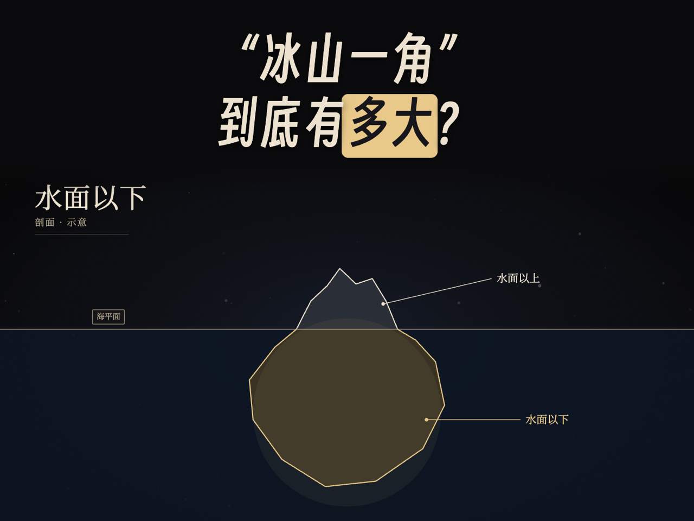
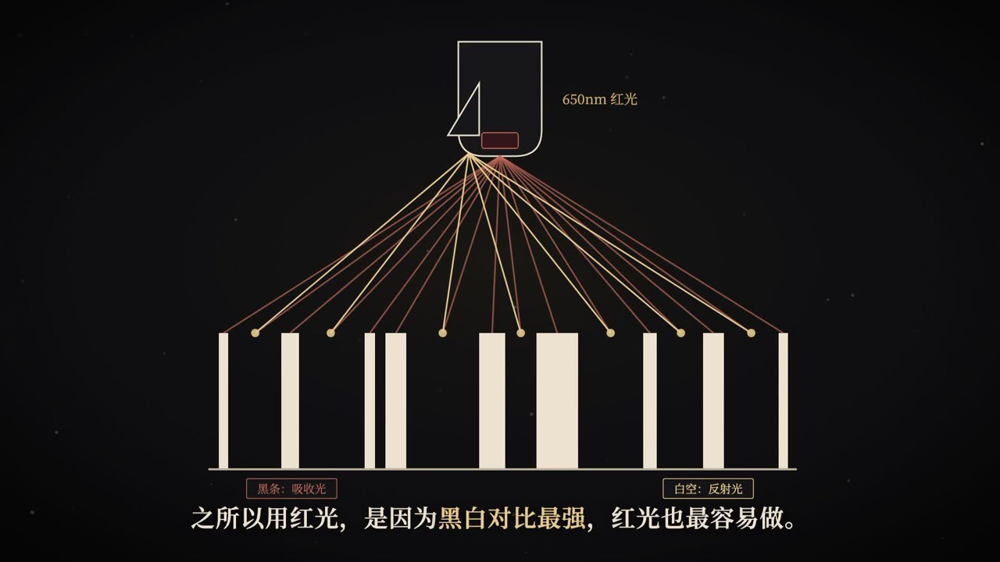

# 黑金科普动画 · 豆包 Skill

把一段提示词发给豆包电脑版，就能自动做出一条**黑底金字、数据图表、线条动画**风格的 1–2 分钟科普短视频（横屏 1080p，带字幕，无配音无音乐，背景音乐后期自己配），还会顺手出横、竖两张封面。

全程由豆包自己写文案、设计分镜、写动画代码、检查画面、渲染出片，**零基础也能用**。

| 封面 | 画面 |
|---|---|
|  |  |

## 一、一句话出片（不用装技能）

> 需要**豆包电脑版**（Windows / macOS），手机版和网页版不行。界面文字可能随版本变化，以实际为准。

1. 新建对话，切换到 **工作任务** 模式，并**勾选「本地电脑」**（视频要在你的电脑上渲染）。
2. 整段粘贴下面的提示词发送，只改「话题」：

   ```
   请帮我全自动做一条科普短视频，中途不用问我：
   1. 下载技能包 https://github.com/jmzm123/heijin-kepu-video-skill/archive/refs/heads/main.zip ，解压到「桌面/黑金科普/技能包」。
   2. 打开解压出来的 heijin-kepu-video/SKILL.md，把它当作技能说明，从第 1 步做到第 7 步，最后告诉我成片在哪。
   话题：为什么猫从高楼摔下来，楼层越高反而可能伤得越轻？
   时长：90 秒左右
   ```

3. 等豆包做完（第一次要装环境，大约 10–20 分钟；之后每条 5–10 分钟）。中途它可能请你允许安装 Node.js、运行命令，点同意即可。
4. 成片在 `桌面/黑金科普/<话题>/out/` 里：`<标题>.mp4` + `封面_横_4比3.png` + `封面_竖_3比4.png`。

想改哪里，直接在同一个对话里说「第 3 场的字幕改成……，重新渲染」。更多写法见 [提示词.md](提示词.md)。

## 二、也可以装成技能（可选）

经常用的话，可以装进豆包，以后提示词只写「请使用「黑金科普动画」技能……话题：……」：

1. 点本页右上角绿色 **Code → Download ZIP**，解压。
2. 打开豆包电脑版，进入 **技能**（「技能 · 连接器 · 伙伴」）→ **我的技能** → 右上角 **新建 → 上传技能**，把 **`heijin-kepu-video`** 文件夹拖进去。

## 三、电脑需要什么

- Windows 10/11 或 macOS，8GB 内存以上。
- **Chrome 或 Edge 浏览器**（Windows 自带 Edge 就行）——渲染画面要用它的内核。
- Node.js 18+（没有的话豆包会帮你装）。
- 能访问国内 npm 镜像（npmmirror.com）。不需要翻墙，不需要任何 API Key。

## 四、它是怎么做的

```
话题 ─▶ 写字幕文案（5–9 场，核实数据） ─▶ 分镜 ─▶ 用 Remotion（React）写每一场的动画
     ─▶ 自检：类型检查 + 每场截图检查排版 ─▶ 渲染 MP4 + 响度标准化 ─▶ 出封面
```

- 视觉规范、组件库、文案写法都写在 `heijin-kepu-video/references/` 里，豆包按这些来做，所以每条视频风格统一。
- 没有配音：每句字幕按字数自动决定停留时长，动画跟着字幕的出现时间走。
- 全部画面用代码绘制，不用网络素材，字体随 npm 离线安装，国内网络可直接渲染。

## 五、目录

```
heijin-kepu-video/          ← 上传到豆包的技能文件夹
├── SKILL.md                ← 技能主说明（豆包读这个）
├── references/             ← 视觉规范、组件手册、文案写法、画面套路、常见问题
└── template/               ← 视频工程模板（Remotion），每次复制一份来改
    ├── src/story.ts        ← 剧本：标题、封面、每场字幕
    ├── src/scenes/         ← 每一场的动画（示例：冰山一角）
    ├── src/components/     ← 背景、字幕、图表、大数字、粒子文字等组件
    ├── scripts/            ← npm run check / render
    └── public/             ← 得意黑字体
提示词.md                    ← 给观众复制的提示词
```

## 六、自己手动跑（开发者）

```bash
cp -r heijin-kepu-video/template my-video && cd my-video
npm install
npm run studio    # 浏览器里实时预览
npm run check     # 类型检查 + 每场截图到 out/check/
npm run gallery   # 所有组件样张
npm run render    # 出片 + 封面到 out/
```

## 背景音乐

默认成片是**无声**的，仓库不附带任何音乐。两种加法：

- 在提示词里加一行「背景音乐：桌面上的 music.mp3」，豆包会自动铺上（循环铺满、结尾淡出、响度标准化）。
- 或者把成片导入剪映等软件自己配。

请使用你有权使用的音乐。

## 许可

代码和文档：MIT。字体和 Remotion 的许可见 [LICENSE](LICENSE)。
